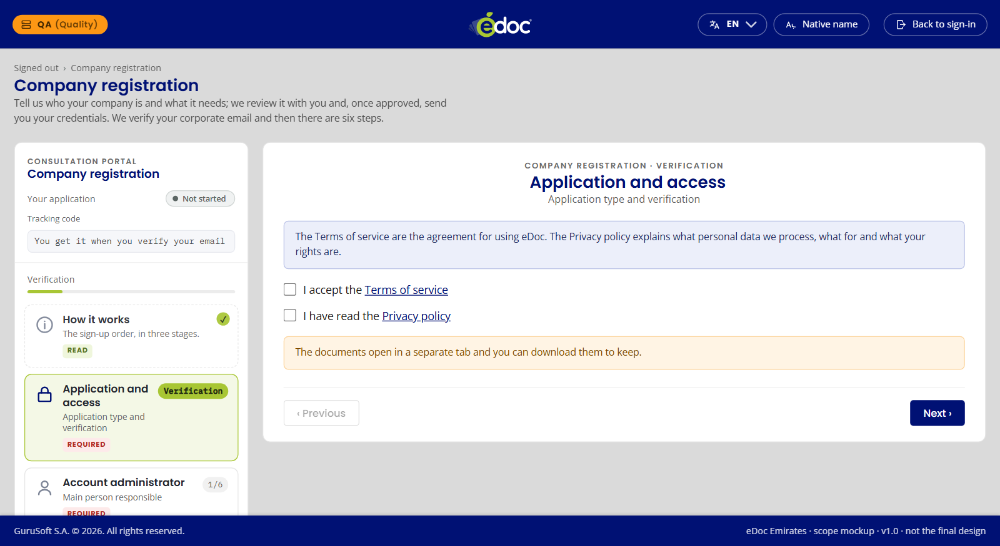
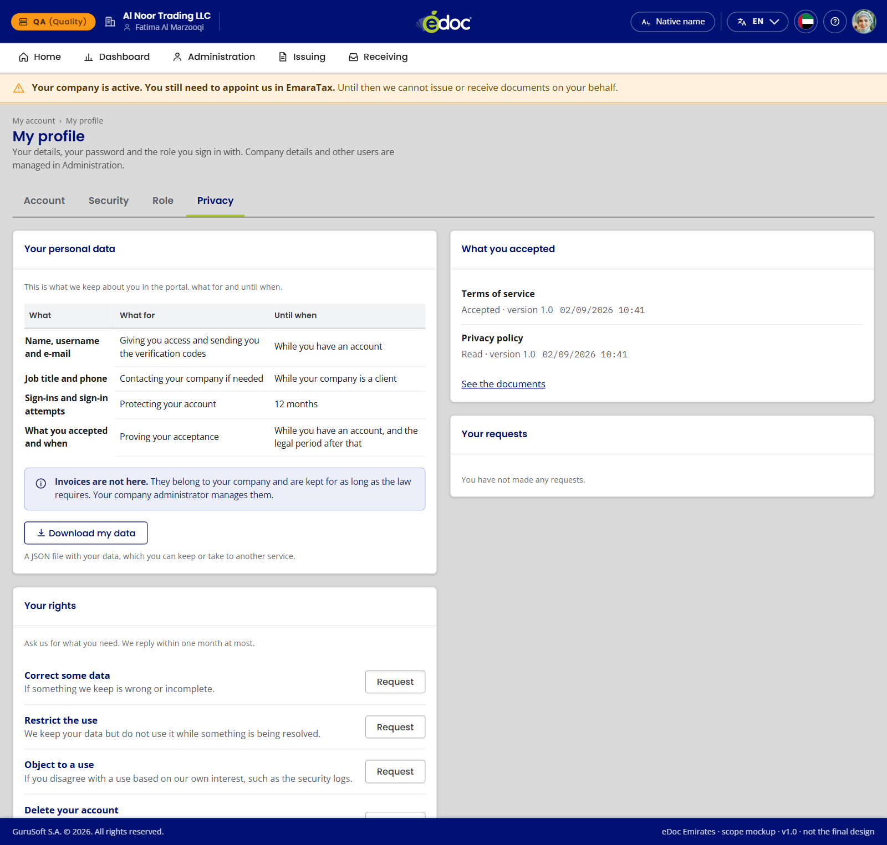
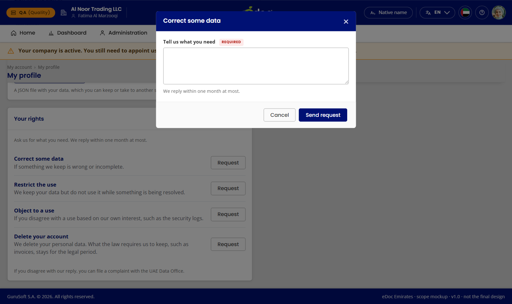
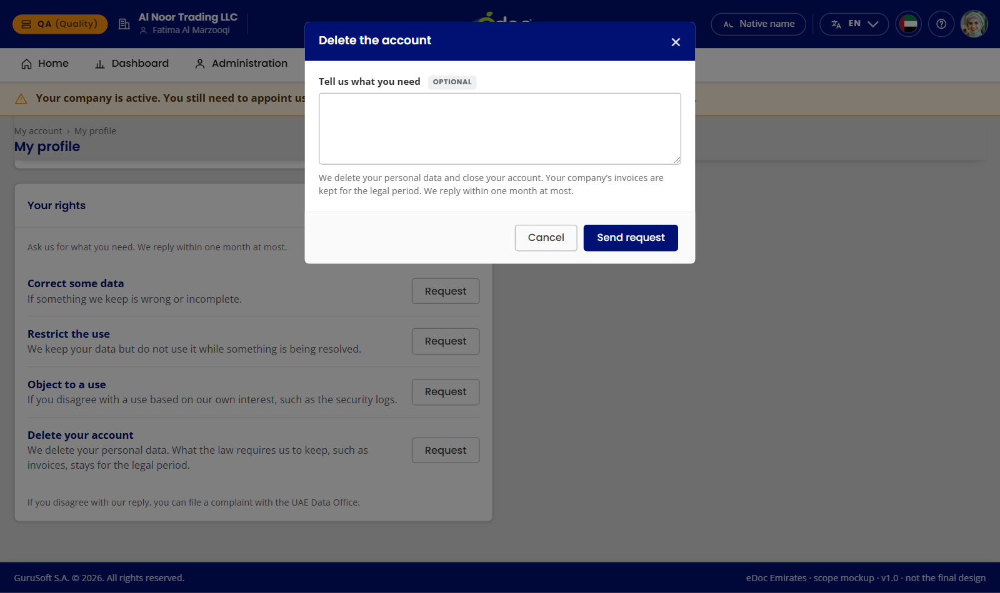
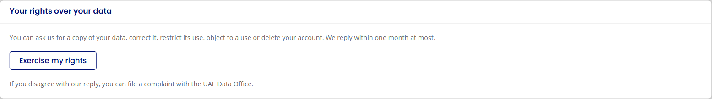
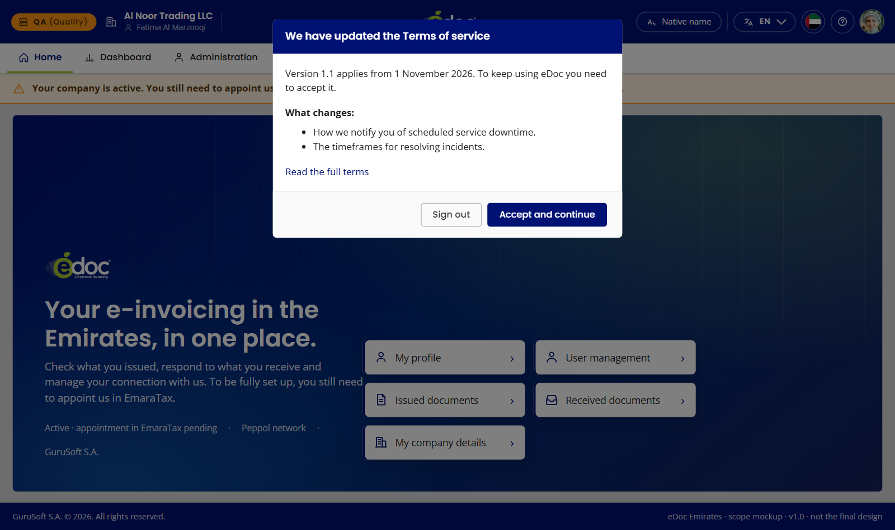
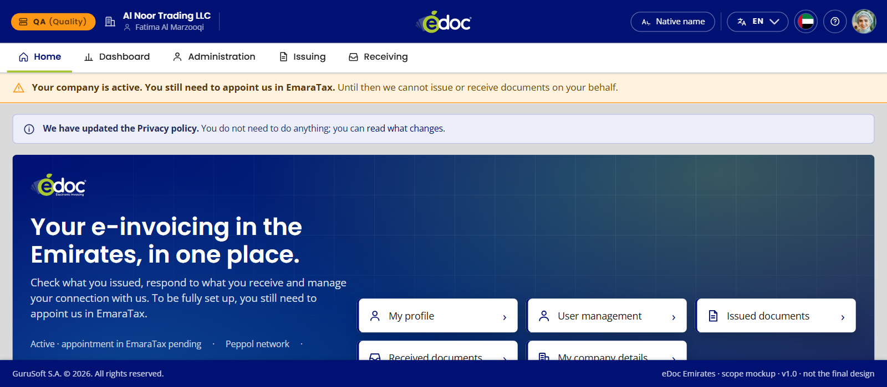
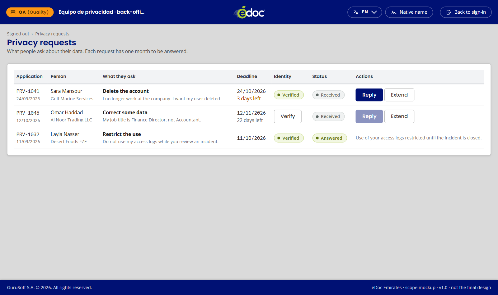

# Privacidad en eDoc Emiratos (épica 3)

Qué norma se aplica en cada pantalla de la épica 3 (historias HU-13 a HU-17), por qué, y de qué documento sale, con la página exacta y el enlace. Al final, la voz y el tono: cómo se escriben estas pantallas para cumplir sin perjudicar al negocio.

Está escrito para producto, desarrollo, legal y gerencia.

**Cómo leer las páginas.** En la ley de Emiratos, la página es la de la edición inglesa de Lexis Middle East (11 páginas). En el RGPD, «DO» es la página del Diario Oficial de la UE (L 119), igual en todos los idiomas. En la guía del Comité Europeo, «apdo.» es el número de párrafo, que no cambia entre versiones.

**Verificado el 21 de octubre de 2026** contra los textos. Cuando algo no se pudo comprobar, lo dice: «por confirmar».

---

## 1. Los documentos

| Código | Documento | Enlace |
|---|---|---|
| **PDPL** | Federal Decree-Law No. 45 of 2021 on the Protection of Personal Data (ley de datos de Emiratos). En vigor desde el 02/01/2022. | Oficial: [uaelegislation.gov.ae · ley 45/2021](https://uaelegislation.gov.ae/en/legislations/1972). El portal pide una verificación de navegador, así que las páginas se citan de la edición inglesa de Lexis Middle East: [PDF de 11 páginas](https://privacyarabia.com/wp-content/uploads/2022/08/Decree-Law-45-2021-Data-Protection-Law-English.pdf) ([ficha en Lexis](https://www.lexismiddleeast.com/law/UnitedArabEmirates/DecreeLaw_45_2021/en)). Resumen del gobierno: [u.ae · leyes de protección de datos](https://u.ae/en/about-the-uae/digital-uae/data/data-protection-laws). |
| **RGPD** | Reglamento (UE) 2016/679, DO L 119 de 04/05/2016. | [DOUE en español (BOE)](https://www.boe.es/doue/2016/119/L00001-00088.pdf) · [EUR-Lex](https://eur-lex.europa.eu/eli/reg/2016/679/oj) |
| **EDPB** | Comité Europeo de Protección de Datos, Directrices 05/2020 sobre el consentimiento, v1.1. | [edpb.europa.eu · directrices 05/2020 (ES)](https://www.edpb.europa.eu/system/files/documents/files/file1/edpb_guidelines_202005_consent_es.pdf) |
| **MD197** | Ministerial Decision No. 197 of 2026, que modifica la MD 243 (facturación electrónica). En vigor desde el 01/10/2026. | [mof.gov.ae · MD 197](https://mof.gov.ae/wp-content/uploads/2026/10/Ministerial-Decision-No.-197-of-2026-%E2%80%93-Amending-Certain-Provisions-of-Ministerial-Decision-No.-243-of-2025-on-the-Electronic-Invoicing-System_En.pdf) |

---

## 2. Qué ley manda y por qué el componente usa el RGPD

**En Emiratos manda la PDPL.** Se aplica a quien trata datos de personas que residen o tienen negocio en Emiratos, esté donde esté el responsable (**PDPL** art. 2, pág. 3). GuruSoft queda dentro.

**Excepción: las zonas francas con ley propia** (**PDPL** art. 2.g, pág. 3). Un cliente de DIFC o ADGM se rige por la ley de su zona. Hay que saber si tenemos alguno (por confirmar con legal).

**El RGPD es el estándar del componente.** Las pantallas de privacidad son las mismas que en Francia. El RGPD es más exigente que la PDPL en todo lo que tocan estas pantallas, así que cumplirlo cubre la PDPL. Hay cuatro diferencias que se notan en pantalla:

| Tema | PDPL (Emiratos) | RGPD (estándar) | Qué hacemos |
|---|---|---|---|
| Plazo para responder | La ley no lo fija; lo dejará el reglamento ejecutivo (art. 28, pág. 10), que no está publicado. | Un mes, prorrogable dos más avisando (art. 12.3, DO 40). | Un mes, como compromiso propio. |
| Verificar la identidad | La ley no lo dice. | Si hay dudas razonables, se piden datos (art. 12.6, DO 40). | Se verifica, como buena práctica. |
| Oponerse | Solo frente a marketing directo, estadística o un tratamiento ilegal (art. 17, pág. 8). | Más amplio (art. 21, DO 45). | Se ofrece el botón; la respuesta depende del caso. |
| Dónde reclamar | Ante la Oficina de Datos de Emiratos (art. 24, pág. 10). | Ante la autoridad de control (art. 77, DO 80). | En Emiratos, «Legales» debe nombrar la Oficina de Datos de Emiratos (UAE Data Office). |

---

## 3. Por historia

### HU-13 · Aceptar solo lo que es contrato (Registro, paso final)

[Ver en la maqueta](https://gurutestux.vercel.app/Emiratos/registro.html?empezar=1)

*Registro, paso final: dos casillas sin marcar; los términos se aceptan y la política se declara leída.*

| Lo que se ve | Por qué | Emiratos | Estándar |
|---|---|---|---|
| «Accept the Terms of service»: casilla sin marcar, obligatoria. | Es el contrato. Para tratar los datos que el servicio necesita no hace falta consentimiento: basta con el contrato y las obligaciones fiscales. | **PDPL** art. 4, casos 9 (contrato) y 10 (obligación legal), pág. 4 | **RGPD** art. 6.1.b y c, DO 36 |
| «I have read the Privacy policy»: se informa, no se pide aceptar. | La política se da **antes** de tratar los datos: para qué, con quién se comparten y qué pasa si salen del país. | **PDPL** art. 13, último párrafo, pág. 7 | **RGPD** art. 13, DO 40–41 |
| **No hay** casilla obligatoria de «acepto el tratamiento de mis datos». | Condicionar el servicio a un consentimiento que no hace falta lo invalida, y mezclar fines también. Pedirlo de más expone al negocio: si la persona lo retira, parecería que hay que dejar de darle el servicio. | **PDPL** art. 6.B (claro e inequívoco), pág. 4 | **RGPD** art. 7.4, DO 37 · **EDPB** apdo. 30, pág. 10 (contrato, interpretación estricta) y apdo. 44, pág. 12 (un consentimiento por fin) |

### HU-14 · Ver y descargar mis datos (Mi perfil › Privacy)

[Ver en la maqueta](https://gurutestux.vercel.app/Emiratos/mi-perfil.html?pestana=privacidad)

*Mi perfil › Privacy: qué datos, para qué y hasta cuándo; la descarga; lo aceptado y los derechos.*

| Lo que se ve | Por qué | Emiratos | Estándar |
|---|---|---|---|
| Qué datos guardamos, para qué y hasta cuándo. | Es el derecho a la información: tipos de datos, fines y plazos de conservación. | **PDPL** art. 13.1 a, b y e, pág. 7 | **RGPD** art. 15.1, DO 43 |
| «Download my data» descarga un archivo al momento. | Copia en formato estructurado y legible por máquina. | **PDPL** art. 14, pág. 7 | **RGPD** art. 15.3, DO 43 y art. 20.1, DO 45 |
| Las facturas no están aquí. | Son datos de la empresa, no de la persona, y tienen su propia obligación de conservación (HU-15). | — | — |
| «What you accepted»: documento, versión y fecha. | Hay que poder **demostrar** qué aceptó y cuándo. | **PDPL** art. 6.A, pág. 4 | **RGPD** art. 7.1, DO 37 · **EDPB** sección 5.1, pág. 21 |

### HU-15 · Ejercer mis derechos (Mi perfil › Privacy)

[Ver en la maqueta](https://gurutestux.vercel.app/Emiratos/mi-perfil.html?pestana=privacidad) · [Legales](https://gurutestux.vercel.app/Emiratos/legales.html)

*Pedir un derecho: un formulario breve y el plazo de respuesta.*

*Eliminar la cuenta: antes de enviar se dice que las facturas se conservan el plazo legal.*

*Legales: los derechos y dónde reclamar en Emiratos, la Oficina de Datos (UAE Data Office).*

| Lo que se ve | Por qué | Emiratos | Estándar |
|---|---|---|---|
| Un botón por derecho y un formulario breve. | La ley pide medios «apropiados y claros» para ejercerlos. | **PDPL** art. 19, pág. 9 | **RGPD** art. 12.2, DO 40 |
| Corregir. | Corrección sin demora de lo inexacto. | **PDPL** art. 15.1, pág. 7 | **RGPD** art. 16, DO 43 |
| Limitar. | Por ejemplo, mientras se comprueba si un dato es correcto. | **PDPL** art. 16, pág. 8 | **RGPD** art. 18, DO 44 |
| Oponerse. | En Emiratos es más estrecho (apartado 2). | **PDPL** art. 17, pág. 8 | **RGPD** art. 21, DO 45 |
| Eliminar mi cuenta, con el aviso de que las facturas se conservan el plazo legal. | No se borra lo que otra ley obliga a guardar. Las facturas electrónicas se conservan el plazo de la Ley de Procedimientos Tributarios. | **PDPL** art. 15.3.c, pág. 8 · **MD197** art. 11, pág. 2 | **RGPD** art. 17.3.b, DO 44 |
| Respuesta en un mes como máximo. | Compromiso propio: la PDPL no fija plazo (apartado 2). | **PDPL** art. 28, pág. 10 | **RGPD** art. 12.3, DO 40 |
| «Your requests» muestra el estado y la respuesta. | La persona ve qué pasó con lo que pidió, sin prometer avisos que no existen. | **PDPL** art. 19, pág. 9 | **RGPD** art. 12.3, DO 40 |
| «If you disagree with our reply, you can file a complaint with the UAE Data Office» (Mi perfil y Legales). | En Emiratos se reclama ante la Oficina de Datos, y se nombra: «la autoridad de protección de datos» no le dice a la persona adónde ir. | **PDPL** art. 24, pág. 10 | **RGPD** art. 77, DO 80 |

### HU-16 · Volver a aceptar si cambian los términos (Inicio)

[Términos nuevos](https://gurutestux.vercel.app/Emiratos/inicio.html?terminos=nuevos) · [Política nueva](https://gurutestux.vercel.app/Emiratos/inicio.html?privacidad=nueva)

*Términos nuevos: ventana obligatoria con lo que cambia, «Accept and continue» o salir.*

*Política nueva: solo un aviso que informa; no hay que aceptar nada.*

| Lo que se ve | Por qué | Emiratos | Estándar |
|---|---|---|---|
| Si cambian los términos: ventana obligatoria con lo que cambia, «Accept and continue» o salir. Queda la versión y la hora. | Un contrato nuevo se acepta otra vez, y la aceptación tiene que poder demostrarse. | **PDPL** art. 6.A, pág. 4 | **RGPD** art. 7.1, DO 37 |
| Si solo cambia la política de privacidad: un aviso que informa, sin pedir aceptar. | La política informa; no es un consentimiento. Pedir que se acepte la convertiría en uno. | **PDPL** art. 13, pág. 7 | **RGPD** art. 12.1, DO 39 |

### HU-17 · Atender las solicitudes (bandeja interna)

[Ver en la maqueta](https://gurutestux.vercel.app/Emiratos/privacidad-solicitudes.html)

*Bandeja interna: cada solicitud con su plazo; «Reply» espera a verificar la identidad.*

| Lo que se ve | Por qué | Emiratos | Estándar |
|---|---|---|---|
| Semáforo con el plazo de cada solicitud. | Se responde dentro del mes que prometemos. | **PDPL** art. 28, pág. 10 (sin plazo propio) | **RGPD** art. 12.3, DO 40 |
| «Reply» espera a verificar la identidad. | Entregar datos a quien no es el titular sería una filtración. | — (la ley no lo regula) · **PDPL** art. 13.3.d, pág. 7 (no si afecta a datos de otros) | **RGPD** art. 12.6, DO 40 |
| «Extend» exige el motivo. | La prórroga se avisa a la persona con su motivo. | — | **RGPD** art. 12.3, DO 40 |
| Se puede rechazar una solicitud repetida o abusiva, con motivo. | La ley lo permite si no está relacionada o es excesivamente repetitiva. | **PDPL** art. 13.3.a, pág. 7 | **RGPD** art. 12.5, DO 40 |

---

## 4. Voz y tono

Las capturas de arriba ya están ajustadas a estas reglas. Las reglas generales de la vinculación también valen aquí: formal, breve, sin jerga, sin avisos flotantes, en inglés y sin prometer lo que no existe. Estas son las propias de la privacidad.

### 4.1 Pedir solo lo necesario

- **No se pide consentimiento para lo que ya cubre el contrato.** Más casillas no protegen más: complican, y un consentimiento retirado puede chocar con el servicio.
- **Informar no es aceptar.** La política se presenta con «I have read», no con «I accept».
- **Casillas sin marcar.** Nada viene marcado de antemano.
- **Un fin, un permiso.** Si algún día hace falta un consentimiento (por ejemplo, para marketing), va aparte y se puede retirar con la misma facilidad con que se dio.

### 4.2 Decir qué pasa de verdad

- **Eliminar no borra las facturas,** y se dice antes de confirmar: «What the law requires us to keep, such as invoices, is kept for the legal period». Prometer un borrado total sería falso y nos expondría.
- **El plazo es el que podemos cumplir:** un mes. No se escribe «inmediato» ni «en 24 horas».
- **No se prometen avisos por correo** si no hay un sistema que los envíe. El estado se ve en «Your requests».

### 4.3 Sin trampas de diseño

- Los derechos están a la vista, uno por botón. Eliminar la cuenta no se esconde ni pide más pasos que los necesarios.
- La ventana de términos nuevos dice qué cambia y deja salir sin aceptar.
- Los textos explican para qué se usa cada dato con palabras de usuario, no con nombres de sistema.

### 4.4 Lo que protege al negocio

- **Menos consentimientos, menos riesgo.** El servicio se apoya en el contrato y en la ley, que no se pueden «retirar».
- **Todo queda demostrado.** Versión, fecha y hora de cada aceptación.
- **Las facturas se conservan siempre** el plazo legal, aunque la persona pida eliminar su cuenta.
- **Identidad antes de responder.** Ningún dato sale sin verificar a quién se le da.
- **Cada pantalla, con su fuente.** Si la norma cambia (llegará el reglamento ejecutivo de la PDPL), se sabe qué revisar.

---

## 5. Ajustes hechos y pendientes

**Hechos el 21 de octubre de 2026:**

- **Dónde reclamar.** Mi perfil y Legales nombran la Oficina de Datos de los Emiratos (UAE Data Office) en lugar de «la autoridad de protección de datos» (**PDPL** art. 24, pág. 10).
- **Notas de diseño.** Las de Mi perfil, la bandeja de solicitudes, Inicio, Legales y Registro citan la PDPL como norma y el RGPD como estándar del componente. También los comentarios de `assets/js/privacidad.js`.

**Pendientes:**

1. **Plazo de conservación de las facturas:** el número de años que fija la Ley de Procedimientos Tributarios, por confirmar con legal.
2. **Clientes en DIFC o ADGM:** saber si los hay; tienen ley propia.
3. **Reglamento ejecutivo de la PDPL:** cuando se publique, revisar plazos y casos.
4. **Contacto de privacidad** y texto de la política: los da legal.
