# Pruebas y evidencias de la vinculación con EmaraTax

Cada captura que pide la plantilla de evidencias, con la pantalla de eDoc tal como debe verse y el enlace para abrirla en la maqueta. Sirve para preparar el día de las evidencias de la etapa 2 (Sandbox testing) y para que desarrollo compare su versión con la maqueta, captura por captura.

**Fuentes:** la plantilla de evidencias del equipo, «UAE E-invoicing · End-User Scenario Test Evidence» (`UAE_EA_Evidence_Onboarding.docx`), que sigue la «UAE E-invoicing End-User Scenario Template for ASPs» de la autoridad (borrador 1.0) y conserva su numeración; la guía de pruebas «FTA Onboarding Testing Overview» (1.0); el proceso del usuario final (V1.2, sección 7); y la revisión del 29 de octubre de 2026 con Alejandro, José, Miguel y Felipe.

**Cómo usar los enlaces:** abren la maqueta en inglés, como se verá en producción. Para verla en español, añade `&idioma=es`. La maqueta no consulta a la autoridad: cada enlace enseña la respuesta de ese caso. Las capturas de este documento son de la maqueta, con el sello «SANDBOX» que llevará el ambiente de pruebas; las de la evidencia se toman en el ambiente real.

---

## 1. Resumen

| Parte de la plantilla | Capturas en eDoc | En EmaraTax | De desarrollo |
|---|---|---|---|
| 2 y 3. EmaraTax y persona del IVA | — | 4 | — |
| 4. Alta | 11 | 3 | 5 |
| 5. Reverificación | 5 | 3 | 3 |
| 6. Baja | 4 | 3 | 3 |
| 7. Baja y nueva alta con el mismo ASP | Las mismas del alta | 3 | 4 |

«De desarrollo» son las capturas de la llamada a la API, las respuestas de Peppol y la recuperación cuando algo no responde: no se ven en la pantalla y las prepara desarrollo.

---

## 2 y 3. EmaraTax y la persona del IVA

Pantallas de la autoridad: la captura se toma en EmaraTax, con el usuario de prueba.

| N.º | Captura | Dónde se toma |
|---|---|---|
| 2.1 | Inicio de sesión correcto | EmaraTax |
| 2.2 | Lista de personas obligadas del usuario | EmaraTax |
| 3.1 | Persona del IVA elegida | EmaraTax |
| 3.2 | Pestaña E-invoicing y el aviso («disclaimer») | EmaraTax |

---

## 4. Alta (Onboarding Process)

| N.º | Captura | Dónde se toma |
|---|---|---|
| 4.0 | Lista de proveedores, GuruSoft elegido y «Yes» | EmaraTax |
| 4.3.1 | El TIN vinculado a GuruSoft («Linkage Status with ASP») | EmaraTax |
| 4.4.1 | Cierre de sesión, con la hora | EmaraTax |

### 4.1.1 Página de llegada, sin el código a la vista

**Qué pide la plantilla:** «Capture the redirection to the ASP landing page after onboarding. The authentication code must be hidden/redacted.»

**Qué se ve en eDoc:** La bienvenida, aparte del formulario: «Thank you for choosing us as your ASP», con el sello «SANDBOX» arriba a la izquierda. El código de EmaraTax se borra de la dirección al llegar: la captura de la evidencia tiene que incluir la barra del navegador.

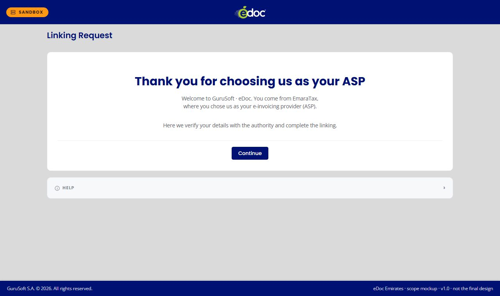

*Página de llegada (4.1.1)*

[Abrir en la maqueta](https://gurutestux.vercel.app/Emiratos/tax-onboard.html?emarataxToken=abc123)

### 4.1.2 Datos del solicitante en blanco

**Qué pide la plantilla:** «Capture the application details page with the email, TIN, and optional mobile number fields initially blank.»

**Qué se ve en eDoc:** Tras «Continue», el formulario vacío. El móvil no lleva texto de ejemplo, para que no parezca un dato ya escrito.

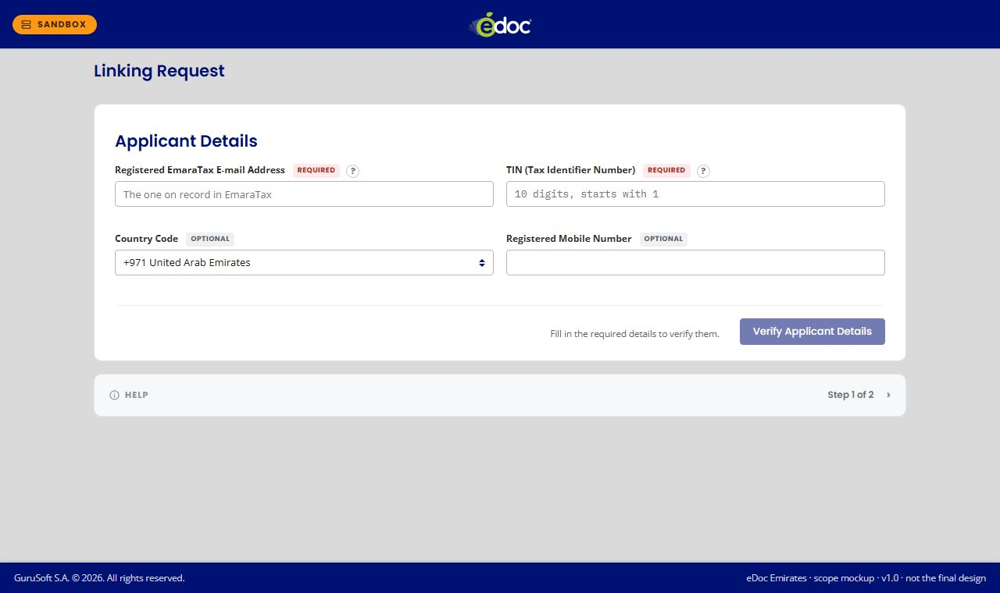

*Formulario en blanco, con «Verify Applicant Details» desactivado (4.1.2)*

[Abrir en la maqueta](https://gurutestux.vercel.app/Emiratos/tax-onboard.html?emarataxToken=abc123&resultado=formulario)

### 4.1.3 Validación de cada campo: TIN y correo

**Qué pide la plantilla:** «TIN starts with 1 and has the required 10-digit length; email format validation (for example, @ and a domain suffix). Invalid values are rejected with clear validation feedback.»

**Qué se ve en eDoc:** Al salir de cada campo, su mensaje propio y en inglés, nunca el del navegador: «Enter a valid email, with @ and a domain…» y «The TIN must have 10 digits and start with 1».

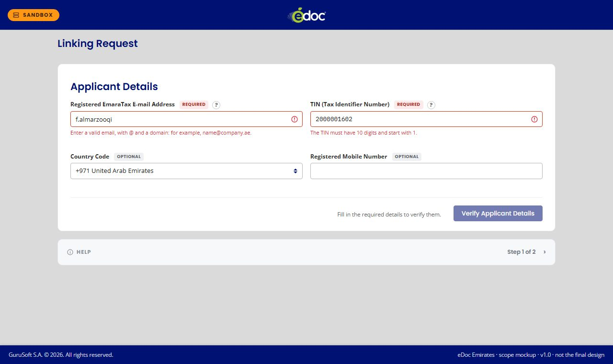

*Correo sin dominio y TIN que no empieza por 1 (4.1.3)*

[Abrir en la maqueta](https://gurutestux.vercel.app/Emiratos/tax-onboard.html?emarataxToken=abc123&resultado=formulario)

### 4.1.4 «Verify» desactivado hasta que todo es válido

**Qué pide la plantilla:** «Capture the UI showing that Validate cannot be clicked until the required field validations are complete.»

**Qué se ve en eDoc:** El botón sigue desactivado mientras falte un dato obligatorio o haya uno mal escrito, y al lado dice por qué: «Fill in the required details to verify them».

*Correo válido y TIN vacío: «Verify Applicant Details» desactivado (4.1.4)*

[Abrir en la maqueta](https://gurutestux.vercel.app/Emiratos/tax-onboard.html?emarataxToken=abc123&resultado=formulario)

### 4.2.1 Correo correcto e incorrecto, distinguibles

**Qué pide la plantilla:** «Capture both a correct registered email scenario and an incorrect email scenario when Verify is clicked. Correct and incorrect email outcomes are distinguishable.»

**Qué se ve en eDoc:** Correcto: pasa directo a la vista de los datos, en una sola vista como la de la autoridad: arriba el correo y el TIN que escribió, bloqueados y con su visto («Verified with EmaraTax»), y debajo los datos de la entidad. Incorrecto: «The email does not match EmaraTax», con qué correo usar y, aparte y más pequeño, los canales oficiales de soporte de la FTA. El TIN que no coincide tiene su propio mensaje.

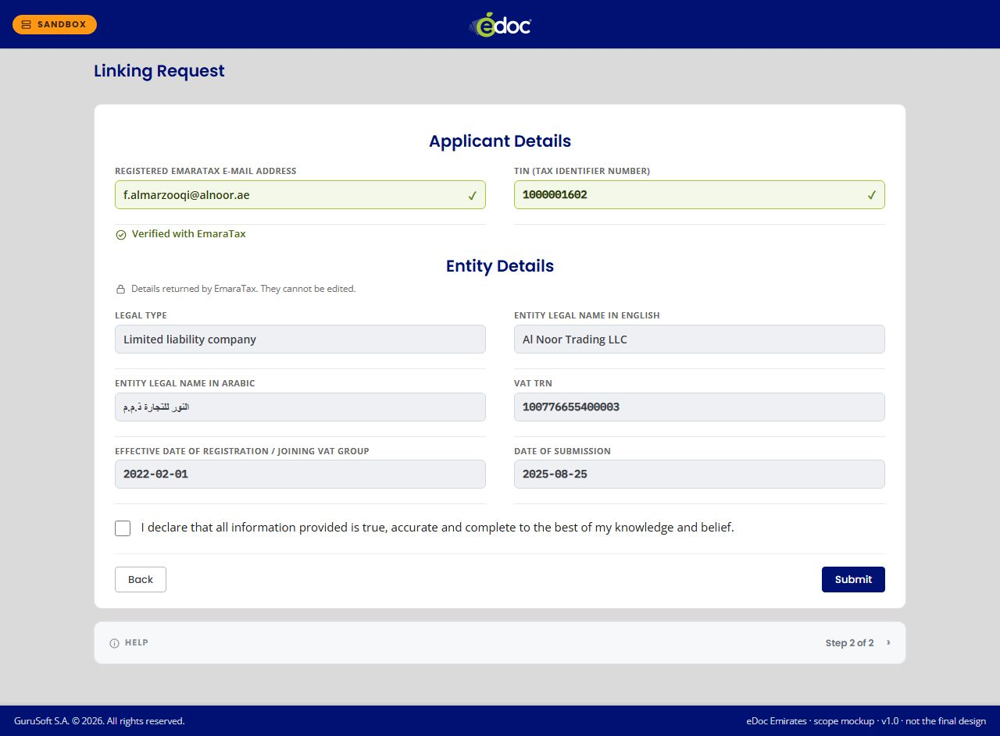

*Correo correcto: correo y TIN verificados y, debajo, los datos de la entidad (4.2.1 y 4.2.2)*

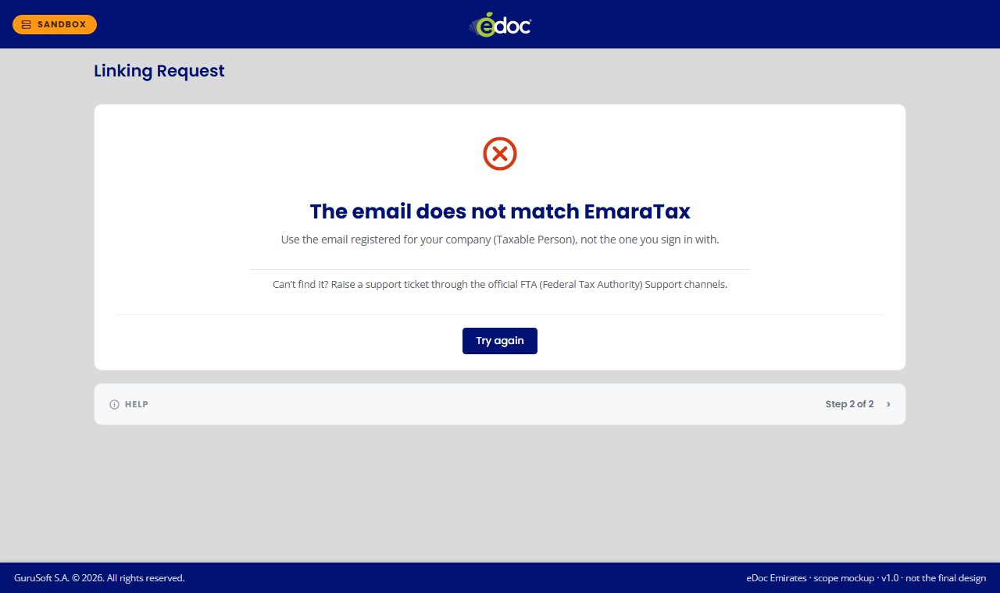

*Correo incorrecto (4.2.1)*

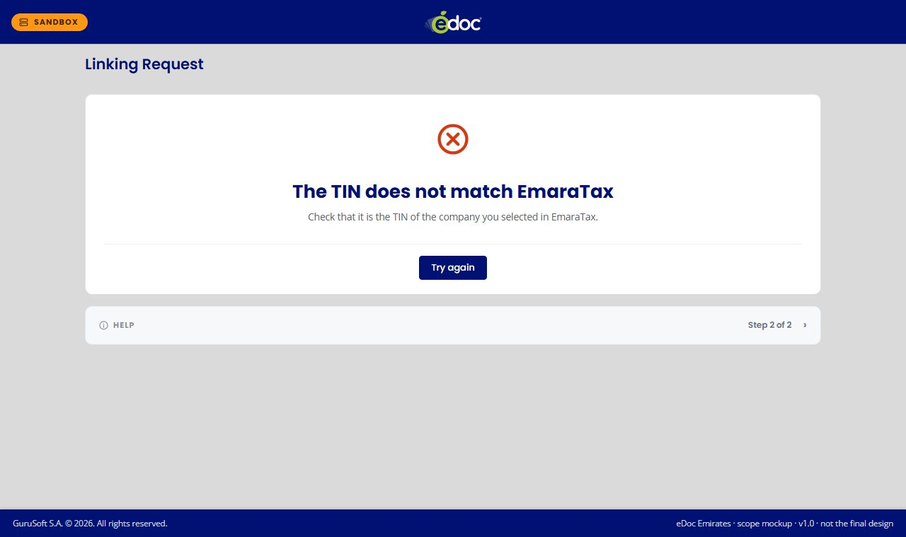

*TIN que no coincide, con su propio mensaje*

[Abrir en la maqueta](https://gurutestux.vercel.app/Emiratos/tax-onboard.html?emarataxToken=abc123&resultado=ok)

### 4.2.2 Datos de EmaraTax, sin edición

**Qué pide la plantilla:** «Capture the response details page populated from EmaraTax, showing that returned fields cannot be edited.»

**Qué se ve en eDoc:** Los datos con aspecto de campo bloqueado y la línea «Details returned by EmaraTax. They cannot be edited.» Es la misma vista de la captura 4.2.1.

[Abrir en la maqueta](https://gurutestux.vercel.app/Emiratos/tax-onboard.html?emarataxToken=abc123&resultado=ok)

### 4.2.3 Casilla de la declaración y «Submit»

**Qué pide la plantilla:** «Capture selection of the required checkbox and submission action. The user can submit after reviewing the details and selecting the checkbox.»

**Qué se ve en eDoc:** La casilla, más grande y con letra más grande. Sin marcarla, «You must accept the declaration to continue»: la revisión del 29 pidió capturar también este caso negativo.

*Declaración marcada, lista para «Submit» (4.2.3)*

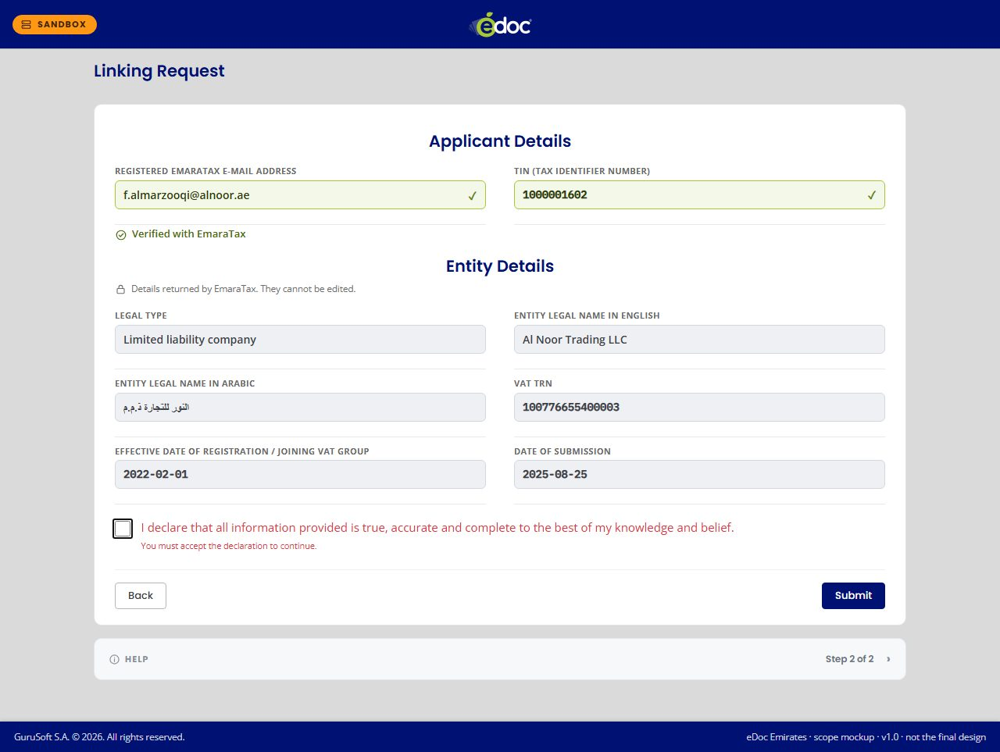

*«Submit» sin marcar la declaración (4.2.3, negativo)*

[Abrir en la maqueta](https://gurutestux.vercel.app/Emiratos/tax-onboard.html?emarataxToken=abc123&resultado=sincasilla)

### 4.2.4 Peppol: el TIN ya está vinculado

**Qué pide la plantilla:** «Capture the Peppol response when the TIN is already linked, including the relevant API request/response.»

**Qué se ve en eDoc:** Si el TIN ya está en Peppol con otro proveedor: «Your company is already registered in Peppol with another provider» y «We have not changed anything». La llamada y la respuesta de Peppol las aporta desarrollo.

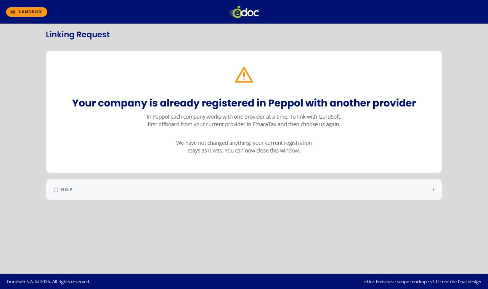

*TIN ya registrado en Peppol con otro proveedor (4.2.4)*

[Abrir en la maqueta](https://gurutestux.vercel.app/Emiratos/tax-onboard.html?emarataxToken=abc123&resultado=peppol)

### 4.2.5 Peppol: éxito y falla

**Qué pide la plantilla:** «Provide evidence of both successful and failed Peppol API responses.»

**Qué se ve en eDoc:** Éxito: «Process completed», y la ayuda se abre sola con el paso siguiente resaltado: comprobar que el ASP GuruSoft aparece en «Linkage Status with ASP» y, si no aparece, contactar con el soporte de eDoc. Falla: «We could not complete the request».

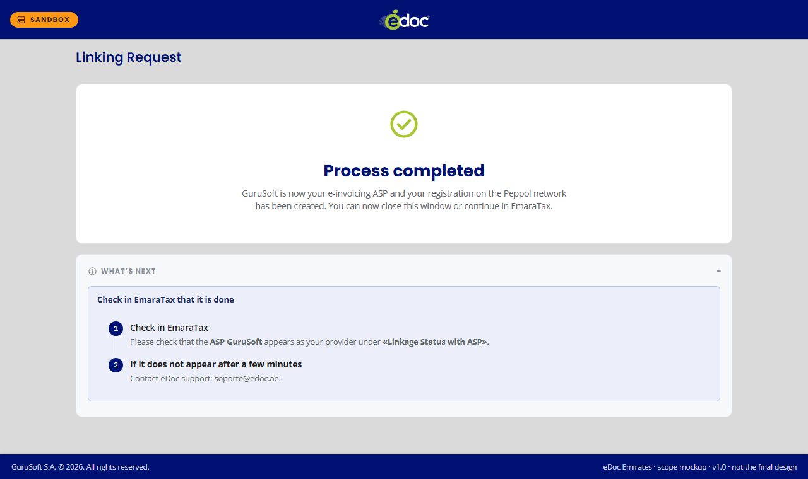

*Alta completada (4.2.5, éxito)*

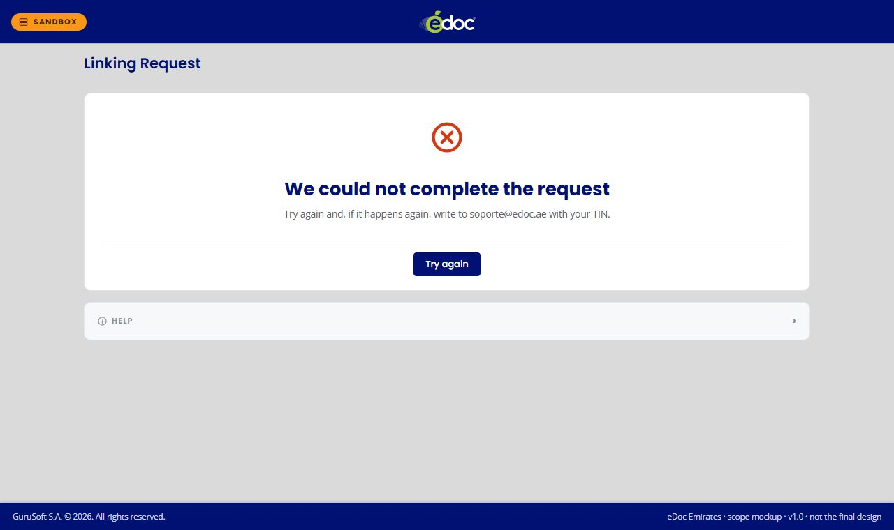

*Falla al enviar (4.2.5, falla)*

[Abrir en la maqueta](https://gurutestux.vercel.app/Emiratos/tax-onboard.html?emarataxToken=abc123&resultado=completado)

### 4.2.6 y 4.2.7 El ASP o EmaraTax no responden

**Qué pide la plantilla:** «Simulate the case where a Peppol request is initiated but the ASP is down…» y «Simulate EmaraTax being unable to receive the ASP response… The ASP's retry, reconciliation, or exception handling is evidenced as implemented.»

**Qué se ve en eDoc:** La persona ve «We could not complete the registration right now»: se volverá a intentar automáticamente y, si el problema persiste, el soporte de eDoc. La recuperación —la tabla de procesos y el proceso automático que retoma los que quedaron a medias— la evidencia desarrollo.

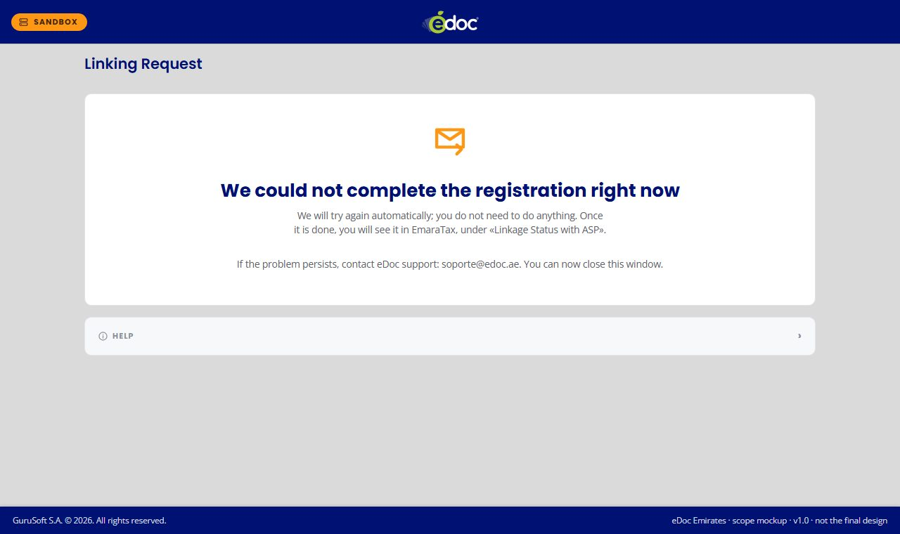

*No se pudo completar ahora; se reintenta solo (4.2.6 y 4.2.7)*

[Abrir en la maqueta](https://gurutestux.vercel.app/Emiratos/tax-onboard.html?emarataxToken=abc123&resultado=espera)

---

## 5. Reverificación (Reverification Process)

| N.º | Captura | Dónde se toma |
|---|---|---|
| 5.0 y 5.0.1 | Inicio de sesión y elegir «Reverify» para el TIN vinculado | EmaraTax |
| 5.3.1 | Los datos actualizados en EmaraTax | EmaraTax |
| 5.4.1 | Cierre de sesión, con la hora | EmaraTax |

### 5.1.1 y 5.1.2 Llegada con «Reverify» elegido y el TIN bloqueado

**Qué pide la plantilla:** «Show the Reverify/Offboard radio options with Reverify selected» y «Capture the TIN prepopulated on the ASP page and show that it cannot be edited.»

**Qué se ve en eDoc:** En la reverificación no hay bienvenida: la página abre ya con las dos opciones, como pide la plantilla. El TIN lo pone la autoridad y no se puede cambiar.

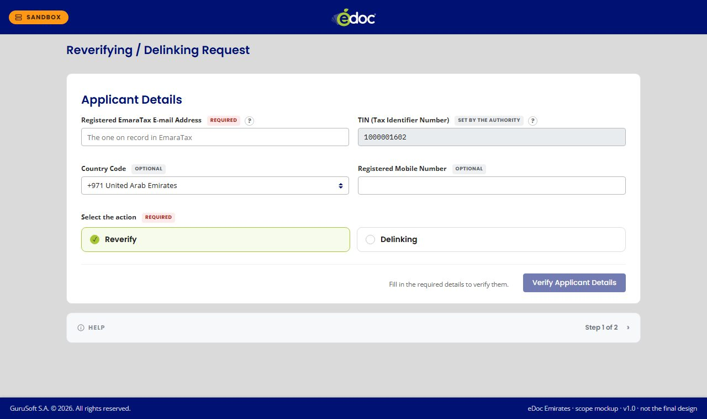

*«Reverify» elegido y TIN bloqueado (5.1.1 y 5.1.2)*

[Abrir en la maqueta](https://gurutestux.vercel.app/Emiratos/tax-onboard.html?emarataxToken=abc123&TIN=1000001602)

### 5.1.3 Validación del correo y «Verify» desactivado

**Qué pide la plantilla:** «Capture email format validation and evidence that Validate cannot proceed until required validations are complete.»

**Qué se ve en eDoc:** El mensaje del correo y el botón desactivado mientras falte el correo válido o la opción.

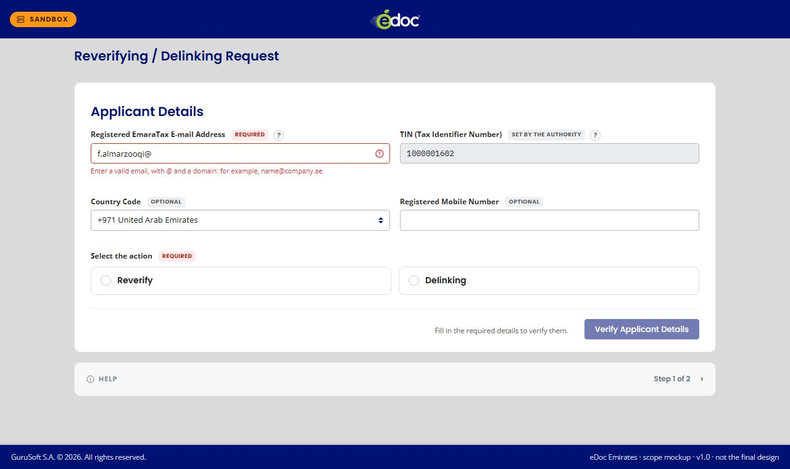

*Correo mal escrito y sin opción elegida: «Verify» desactivado (5.1.3)*

[Abrir en la maqueta](https://gurutestux.vercel.app/Emiratos/tax-onboard.html?emarataxToken=abc123&TIN=1000001602)

### 5.2.1 Correo correcto e incorrecto

**Qué pide la plantilla:** «Capture reverification with an incorrect email and with the correct registered email.»

**Qué se ve en eDoc:** Lo mismo que en el alta: el correo y el TIN verificados en la vista de los datos, y el mensaje del correo que no coincide.

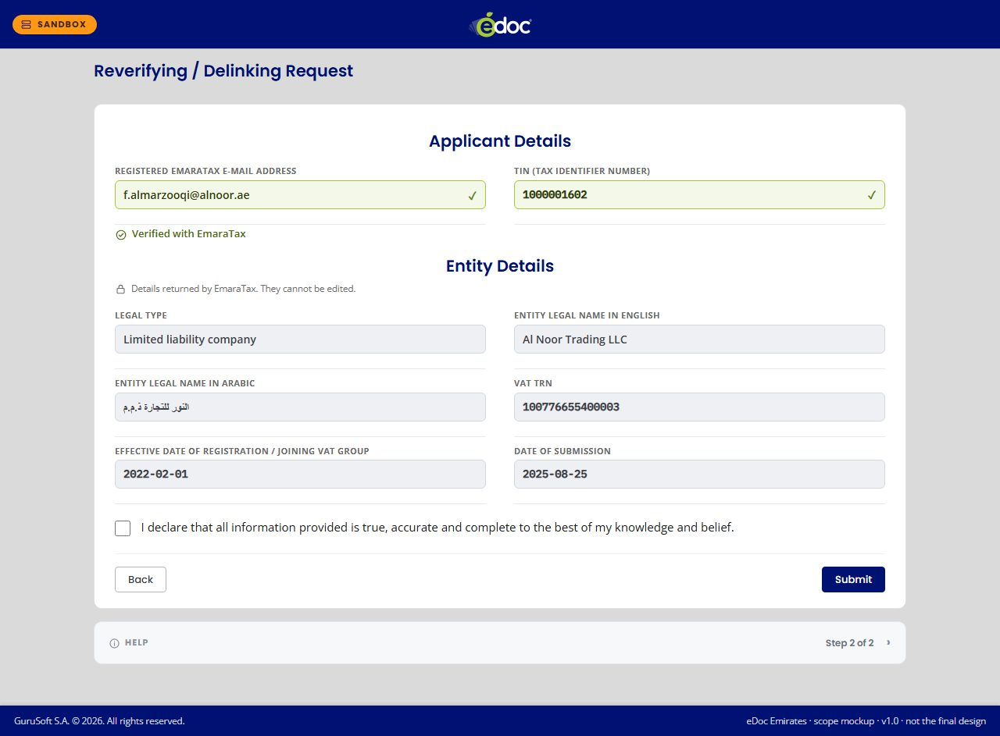

*Correo correcto (5.2.1)*

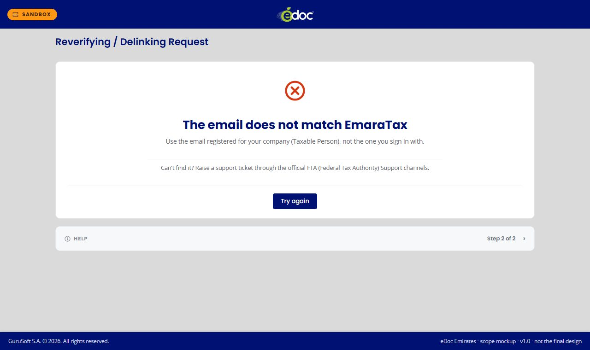

*Correo incorrecto (5.2.1)*

[Abrir en la maqueta](https://gurutestux.vercel.app/Emiratos/tax-onboard.html?emarataxToken=abc123&TIN=1000001602&resultado=ok)

### 5.2.2 y 5.2.3 Datos sin edición, casilla, «Submit» y datos actualizados

**Qué pide la plantilla:** «Capture prepopulated EmaraTax response fields that cannot be edited» y «Capture checkbox selection, submission, and the updated details returned from Peppol.»

**Qué se ve en eDoc:** La ficha bloqueada, como en el alta (4.2.2), y al terminar «Your details have been updated with GuruSoft as your ASP».

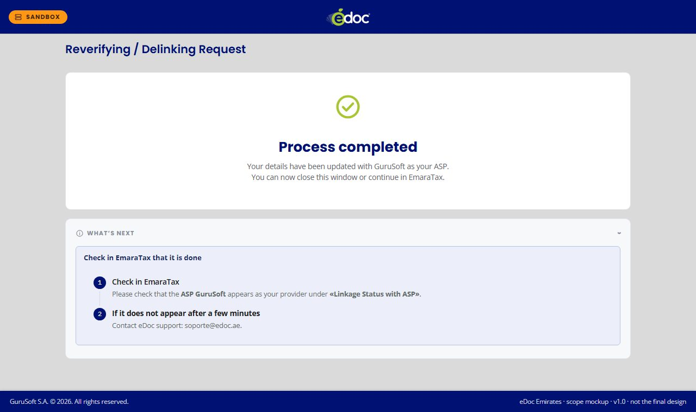

*Reverificación completada (5.2.3)*

[Abrir en la maqueta](https://gurutestux.vercel.app/Emiratos/tax-onboard.html?emarataxToken=abc123&TIN=1000001602&resultado=completado)

---

## 6. Baja (Offboarding Process)

| N.º | Captura | Dónde se toma |
|---|---|---|
| 6.0 y 6.0.1 | Inicio de sesión y elegir «Offboarding» para el TIN vinculado | EmaraTax |
| 6.3.1 | El estado de baja en EmaraTax | EmaraTax |
| 6.4.1 | Cierre de sesión, con la hora | EmaraTax |

### 6.1.1 a 6.1.3 Llegada con «Offboarding» elegido, TIN bloqueado y validación

**Qué pide la plantilla:** «Show the Reverify/Offboard radio options with Offboarding selected», el TIN sin edición y la validación del correo con «Validate» bloqueado.

**Qué se ve en eDoc:** Igual que la reverificación, con la baja elegida.

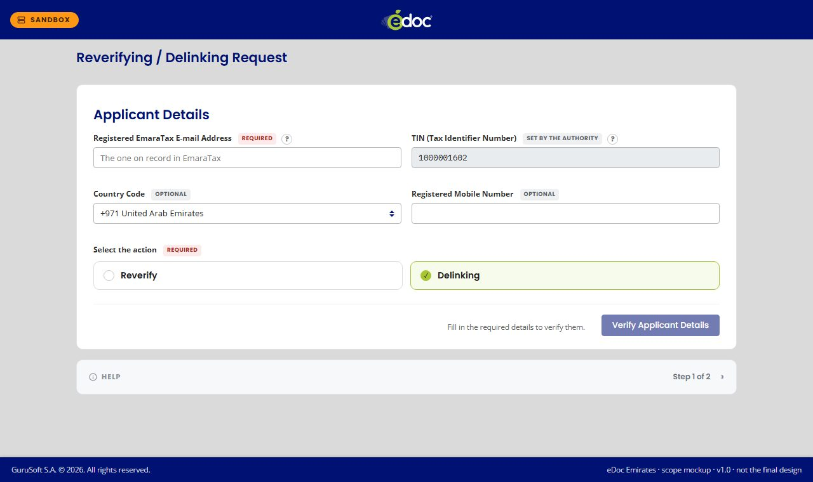

*«Offboarding» elegido y TIN bloqueado (6.1.1 y 6.1.2)*

[Abrir en la maqueta](https://gurutestux.vercel.app/Emiratos/tax-onboard.html?emarataxToken=abc123&TIN=1000001602&accion=baja)

### 6.2.1 a 6.2.3 Correo correcto e incorrecto, datos sin edición, casilla y «Submit»

**Qué pide la plantilla:** Las mismas capturas que en la reverificación, y «the relevant deleted/delinked details returned by Peppol».

**Qué se ve en eDoc:** Al terminar: la baja comunicada, la salida de Peppol en 3 días hábiles como máximo (requisitos de la autoridad Peppol de Emiratos, pág. 2, punto 5) y qué comprobar en EmaraTax.

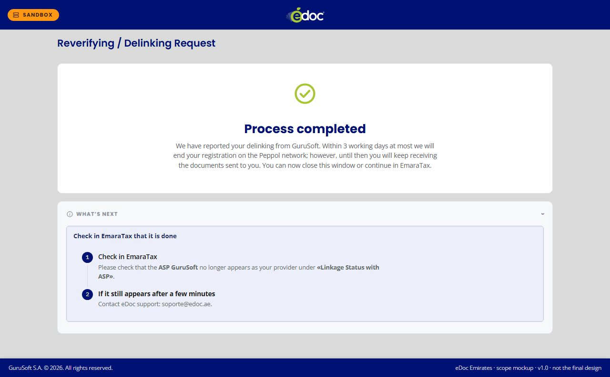

*Baja completada (6.2.3)*

[Abrir en la maqueta](https://gurutestux.vercel.app/Emiratos/tax-onboard.html?emarataxToken=abc123&TIN=1000001602&accion=baja&resultado=completado)

---

## 7. Baja y nueva alta con el mismo ASP

La plantilla repite el alta completa después de una baja (7.1.1 a 7.2.4): son las mismas pantallas del apartado 4, empezando por la bienvenida. Las de EmaraTax son 7.0 (elegir otra vez GuruSoft), 7.3.1 (cierre de sesión) y 7.4.1 (entrada a UAT desde la IP autorizada). El caso 7.2.5 —Peppol borró el vínculo pero eDoc todavía lo muestra como desvinculado— es de desarrollo.

---

## 8. Para preparar la evidencia

Lo pidió Alejandro en las revisiones del 26, el 27 y el 29 de octubre:

- **La numeración de la plantilla, tal cual,** y debajo de cada captura un texto que diga qué muestra: por ejemplo, «la página de llegada, en el ambiente Sandbox, como se ve en el sello de arriba a la izquierda, a las 10:15 hora de Emiratos».
- **La hora de Emiratos en cada captura,** y la de Colombia si hace falta. El equipo que toma las capturas puede poner Windows en la zona «(UTC+04:00) Abu Dabi, Mascate».
- **Un escritorio limpio,** sin otras aplicaciones a la vista, y en el computador de Miguel, desde la IP que tiene registrada la autoridad (plantilla, 7.4.1): si la petición sale de otra IP, puede que no responda.
- **Cero mensajes en español:** el navegador y el equipo, en inglés.
- **Con los datos de prueba de la autoridad:** una captura con otro correo no vale.
- **El documento de trabajo es el de la carpeta del proyecto en SharePoint** (certificación, fase 2), no copias en chats.
- **Ensayar antes:** el día de las evidencias solo se toma cada captura y se pega.

---

## Enlaces

Dirección base: `https://gurutestux.vercel.app/Emiratos/tax-onboard.html`

| Caso | Enlace |
|---|---|
| Bienvenida | [?emarataxToken=abc123](https://gurutestux.vercel.app/Emiratos/tax-onboard.html?emarataxToken=abc123) |
| Formulario en blanco | [?emarataxToken=abc123&resultado=formulario](https://gurutestux.vercel.app/Emiratos/tax-onboard.html?emarataxToken=abc123&resultado=formulario) |
| Correo que no coincide | [?emarataxToken=abc123&resultado=no](https://gurutestux.vercel.app/Emiratos/tax-onboard.html?emarataxToken=abc123&resultado=no) |
| TIN que no coincide | [?emarataxToken=abc123&resultado=notin](https://gurutestux.vercel.app/Emiratos/tax-onboard.html?emarataxToken=abc123&resultado=notin) |
| Datos de la entidad | [?emarataxToken=abc123&resultado=ok](https://gurutestux.vercel.app/Emiratos/tax-onboard.html?emarataxToken=abc123&resultado=ok) |
| Sin marcar la declaración | [?emarataxToken=abc123&resultado=sincasilla](https://gurutestux.vercel.app/Emiratos/tax-onboard.html?emarataxToken=abc123&resultado=sincasilla) |
| Alta completada | [?emarataxToken=abc123&resultado=completado](https://gurutestux.vercel.app/Emiratos/tax-onboard.html?emarataxToken=abc123&resultado=completado) |
| TIN ya en Peppol | [?emarataxToken=abc123&resultado=peppol](https://gurutestux.vercel.app/Emiratos/tax-onboard.html?emarataxToken=abc123&resultado=peppol) |
| Falla al enviar | [?emarataxToken=abc123&resultado=envio](https://gurutestux.vercel.app/Emiratos/tax-onboard.html?emarataxToken=abc123&resultado=envio) |
| No se pudo completar ahora | [?emarataxToken=abc123&resultado=espera](https://gurutestux.vercel.app/Emiratos/tax-onboard.html?emarataxToken=abc123&resultado=espera) |
| Reverificación | [?emarataxToken=abc123&TIN=1000001602](https://gurutestux.vercel.app/Emiratos/tax-onboard.html?emarataxToken=abc123&TIN=1000001602) |
| Reverificación completada | [?emarataxToken=abc123&TIN=1000001602&resultado=completado](https://gurutestux.vercel.app/Emiratos/tax-onboard.html?emarataxToken=abc123&TIN=1000001602&resultado=completado) |
| Baja | [?emarataxToken=abc123&TIN=1000001602&accion=baja](https://gurutestux.vercel.app/Emiratos/tax-onboard.html?emarataxToken=abc123&TIN=1000001602&accion=baja) |
| Baja completada | [?emarataxToken=abc123&TIN=1000001602&accion=baja&resultado=completado](https://gurutestux.vercel.app/Emiratos/tax-onboard.html?emarataxToken=abc123&TIN=1000001602&accion=baja&resultado=completado) |
| Producción, sin sello | [?emarataxToken=abc123&ambiente=prod](https://gurutestux.vercel.app/Emiratos/tax-onboard.html?emarataxToken=abc123&ambiente=prod) |
